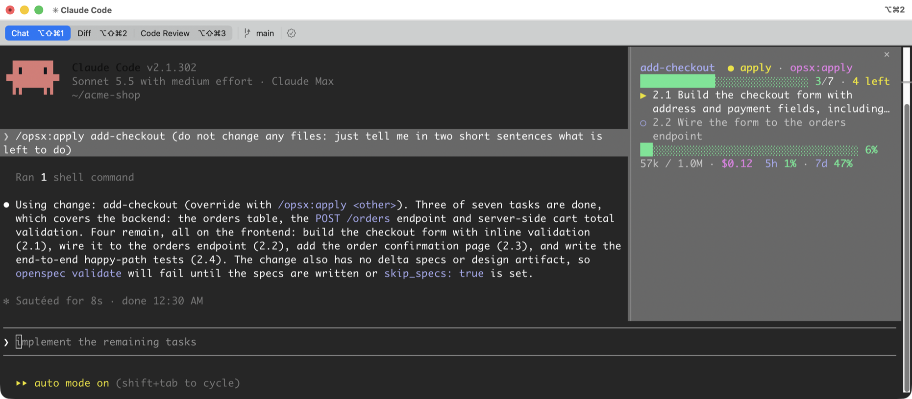
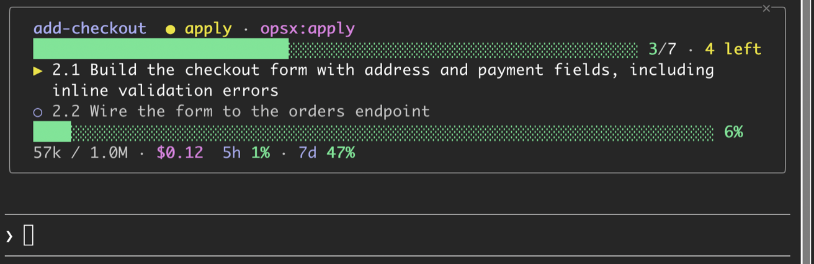
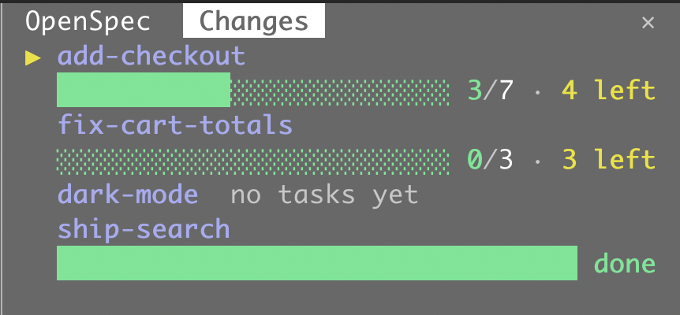

<p align="center">
  <picture>
    <source media="(prefers-color-scheme: dark)" srcset="logos/lockup-dark.svg">
    
  </picture>
</p>

<p align="center">
  <b>See where your <a href="https://github.com/Fission-AI/OpenSpec">OpenSpec</a> change stands, without leaving Claude Code.</b><br>
  Flow step, task progress, running agents, context and usage in one compact panel.
</p>

<p align="center">
  <a href="#quick-start">Quick start</a> ·
  <a href="#features">Features</a> ·
  <a href="#commands">Commands</a> ·
  <a href="#install">Install</a> ·
  <a href="#develop">Develop</a> ·
  <a href="#license">License</a>
</p>

<p align="center">
  
</p>

<p align="center"><i>Side panel next to the transcript (fullscreen UI, 110+ columns).</i></p>

## Features

| | |
|---|---|
| **Follows your flow** | Shows the current step (`explore` → `propose` → `apply` → `verify` → `archive`) from the last OpenSpec skill or `/opsx:*` command. With none, it infers the step from the change's files. |
| **Tasks at a glance** | Progress bar, `done/total · N left`, the current `▶` and next `○` task from `tasks.md`. Refreshes after edits under `openspec/`, at each turn end and every 10s. |
| **All your changes** | `/openspec-changes` opens a second panel listing every active change with its own progress and tasks left. |
| **Agents and MCP** | The running subagent (type, status, description) and the MCP server and tool being called, each on one entry with `+N` for more. |
| **Context and cost** | Context-window bar, tokens used/window, 5h and 7d rate limits on subscriptions, and session cost. |
| **Compact by design** | 8 to 10 rows, 14 at most. No headings, no wasted space. |
| **Wraps, never clips** | Long tasks and descriptions wrap to 2 rows and end with `…` beyond that. |
| **Side by side when wide** | In a wide pane short rows share a row; in a narrow pane they stack. |
| **Theme-aware colors** | One color per kind of info; context and rate limits go green under 60%, yellow under 85%, red above. |

<p align="center">
  
</p>

<p align="center"><i>Inline above the prompt (classic UI or a narrow terminal).</i></p>

## Quick start

1. [Install the plugin](#install).
2. Open a Claude Code session in a repo that uses OpenSpec and run an OpenSpec command such as `/opsx:propose <idea>`.
3. The HUD follows along: flow step, tasks, context and usage update as you work.
4. `/openspec-hud` toggles the panel, `/openspec-changes` shows every change.

## Commands

| Command | What it does |
|---|---|
| `/openspec-hud` | Opens or closes the HUD panel. Closing it with its close mark keeps it closed in later sessions until the command opens it again. |
| `/openspec-changes` | Opens or closes the **Changes** panel. It starts closed, and a close with its close mark sticks until the command reopens it. |

<p align="center">
  
</p>

<p align="center"><i>The Changes panel docks as a tab next to the HUD.</i></p>

## How it reads your project

- **Skill / step**: the last OpenSpec skill (`openspec-*`) or command (`/opsx:*`, `/openspec-*`) used, mapped to the flow step. Without one: no `tasks.md` → propose, open tasks → apply, all done → verify.
- **Change**: the change named in the last `/opsx:<cmd> <change>`, else the most recently edited one under `openspec/changes/` (excluding `archive`).
- **Changes panel**: lists each folder under `openspec/changes/` except `archive`, showing a progress bar with `done/total · N left`, `no tasks yet` without a `tasks.md`, or `done` when every task is checked. The change the HUD follows is first and marked `▶`; the rest follow, most recently edited first.

### Layout

The HUD is a column of rows with no headings. The current and next task, the agent description and the MCP call each take up to 2 rows. In a wide enough pane the change name sits next to its step and skill, and tokens and cost next to the rate limits. Rows with nothing to show (no tasks, no running agent or MCP call) are left out.

**Docking needs the fullscreen terminal UI** at 110+ columns: set `"tui": "fullscreen"` in `~/.claude/settings.json` (or pick it in `/config`). In the classic UI, or a narrower terminal, the panel opens inline above the prompt instead. Drag the panel edge to resize it; it opens 42 columns wide.

## Install

At the prompt of a Claude Code terminal session:

```
/plugin install openspec-hud --marketplace Dash-AI-Tools/openspec-hud
```

Answer `y` to add the marketplace, then pick a scope (**User** for every session, **Project** for this repository only). The panel opens right away.

From a local clone instead:

```
git clone git@github.com:Dash-AI-Tools/openspec-hud.git
claude --plugin-dir ./openspec-hud
```

To update an installed copy: `claude plugin update openspec-hud`, then `/reload-plugins`.

## Develop

```
claude plugin validate .
claude plugin test .
claude --plugin-dir .
```

## Contributing

Issues and pull requests are welcome. See [CONTRIBUTING.md](CONTRIBUTING.md).

## License

[MIT](LICENSE) © 2026 Dash-AI-Tools
